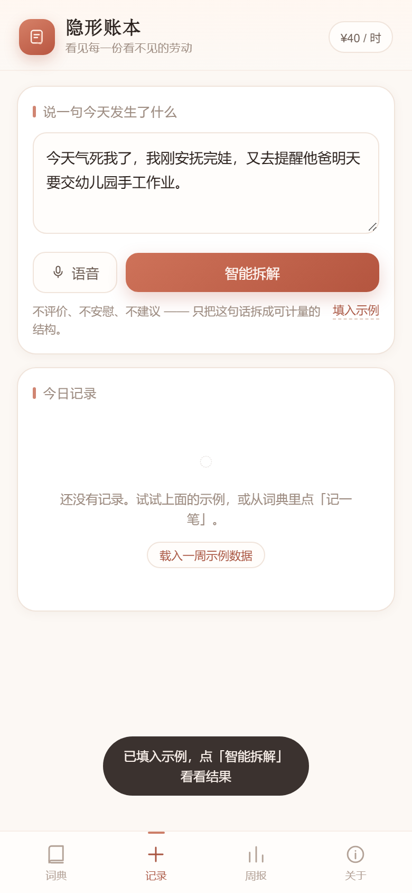
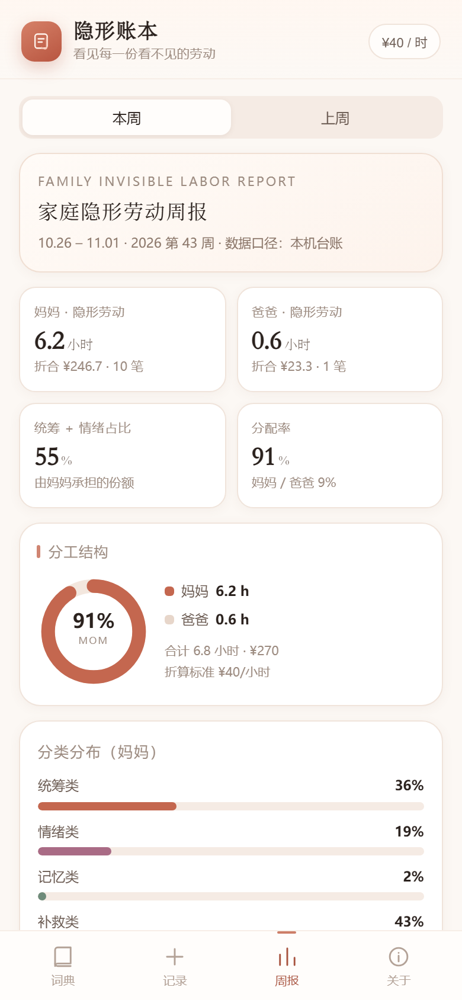
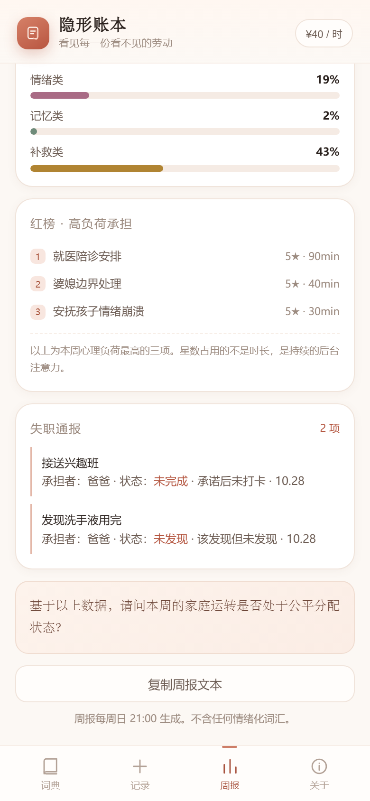

# 隐形账本 · Invisible Ledger

> 看见每一份看不见的劳动。

面向全职妈妈与职场妈妈的一个小工具：把家庭里的**统筹、情绪、记忆、补救**四类隐形劳动，写成可以计量的条目、时长和金额。

不是情绪安抚产品，是一本账。

**[▶ 在线体验](https://fcdhy.github.io/invisible-ledger/)** ｜ 手机浏览器打开后可「添加到主屏幕」，像 App 一样使用；数据只存在你本机。

<p align="center">
  
  
  
</p>
<p align="center">
  
</p>

---

## 三个核心功能

### 1. 隐形劳动词典（56 项 · 4 类 · 心理负荷指数）

全维度分类库，每一项都标注了 **心理负荷指数（1–5★）**、典型耗时与折合金额。

| 分类 | 定义 | 例子 |
| --- | --- | --- |
| **统筹类** | 让家庭这台机器按时运转 | 日用补货预警、疫苗与体检排期、派活与跟进 |
| **情绪类** | 接住每个人的情绪 | 安抚孩子情绪崩溃、婆媳边界处理、咽下自己的情绪 |
| **记忆类** | 全家的外部硬盘 | 水电燃气缴费日、家人用药与过敏史、"妈妈GPS"物品位置 |
| **补救类** | 兜住所有漏下来的事 | 忘带水壶送一趟、发现洗手液用完、半夜起来处理 |

搜索、分类筛选、按负荷排序，任意一条都能「记一笔」直接计入台账。

### 2. 一句话 → 结构化数据

输入一段抱怨或记录（支持语音输入），本地规则引擎会把它拆成若干「隐形任务」，输出固定 JSON：

```
今天气死我了，我刚安抚完娃，又去提醒他爸明天要交幼儿园手工作业
```

↓

```json
{
  "任务名称": "提醒他爸明天要交幼儿园手工作业",
  "任务类型": "记忆类+统筹类",
  "承担者": "妈妈",
  "隐形劳动判定": "是（爸爸没有主动记起，需要妈妈提醒）",
  "预计耗时（分钟）": 15,
  "折合家政时薪价值（元）": 10
}
```

同一句话里的第二个动作也会被单独拆出：`安抚完娃 / 情绪类 / 30 分钟 / ¥20`。

规则细节：
- **承担者判定**：出现「提醒/让/催 + 他爸/爸爸/老公」→ 妈妈承担，爸爸耗时 0；爸爸作为动作主语 → 计入爸爸名下。
- **失职判定**：爸爸 + 「忘带/没带/忘了/没发现」→ 记为 `missed`，不计入其劳动时长，进入周报「失职通报」。
- **耗时**：提醒类固定 15 分钟（这是最短也最容易被低估的一档）；其余按词典条目的典型耗时。
- 纯情绪宣泄（"今天气死我了"）不会被误判成任务。

### 3. 家庭隐形劳动周报（每周日 21:00 生成）

从台账自动聚合，输出：

- **数据展示**：妈妈本周隐性劳动 X 小时 / ¥X；爸爸 X 小时 / ¥X；妈妈承担了 X% 的统筹与情绪劳动；分配率。
- **分工结构**：环形图 + 分类分布条形图。
- **红榜**：本周心理负荷最高的三项（星数占用的不是时长，是后台注意力）。
- **失职通报**：承诺后未打卡 / 该发现但未发现的任务。
- **结论性反问**：*基于以上数据，请问本周的家庭运转是否处于公平分配状态？*
- 一键复制纯文本，可直接发到家庭群。

全文禁用「辛苦」「体谅」「帮忙」等情绪化词汇，只使用「完成 / 未完成 / 承担者 / 分配率」。

---

## 设计原则

1. **只提供结构，不提供安慰。** 应用内没有任何鼓励话术，也没有心理测评。
2. **不提要求，只做记录。** 谁该做什么不是本产品判断的，本产品只负责让分配可见。
3. **数据不出本机。** 无后端、无账号、无埋点，记录只写进 `localStorage`。
4. **金额不是要谁付钱。** ¥40/小时只是给「没有价格的时间」一个可比较的单位，标准可自行修改。

---

## 本地运行

无需构建、无依赖，双击 `index.html` 即可。

需要 HTTP 环境（语音识别要求 secure context）时：

```bash
python -m http.server 8000
# 打开 http://localhost:8000
```

或：

```bash
npx serve .
```

## 部署到 GitHub Pages

线上地址：**https://fcdhy.github.io/invisible-ledger/**

### 方式一：一键脚本（建仓库 + 推送 + 开 Pages）

```bash
GH_TOKEN=github_pat_xxx node deploy-github.js
```

fine-grained token 需要的权限（少一个都会 403，GitHub 会在 `x-accepted-github-permissions` 响应头里写明缺哪项，脚本会直接打印出来）：

| 权限 | 用途 |
| --- | --- |
| **Contents: Read and write** | 推送代码 |
| **Administration: Read and write** | 创建仓库 |
| **Pages: Read and write** | 通过 API 开启 Pages（可省，见下） |

脚本不会把 token 写进 `.git/config`；也支持把 token 放进 `.gh-token`（已在 `.gitignore` 里）或直接作为参数传入。

### 方式二：手动

1. 在 GitHub 网页新建仓库，把本地仓库推上去（`main` 分支）。
2. Settings → Pages → Source 选 **Deploy from a branch** → `main` / `/ (root)`。
3. 访问 `https://<用户名>.github.io/<仓库名>/`。

### 两个实测踩过的坑

- **没有 Pages 权限也能开站**：token 缺 `Pages: write` 时 API 开 Pages 会 403。此时把同一份代码推到 `gh-pages` 分支，GitHub 会自动创建 Pages 站点并以此分支为源，无需任何网页操作。
- **Windows 上 git 报 `CRYPT_E_NO_REVOCATION_CHECK`**：这是本机 schannel 证书吊销检查不可用导致的 TLS 握手失败，不是网络不通。设置 `GIT_SSL_NO_VERIFY=true` 即可（`deploy-github.js` 会先探测，必要时自动降级）。

手机上用 Safari / Chrome 打开后「添加到主屏幕」，会以独立应用形式启动（已附 `manifest.json` 与图标）。

---

## 目录结构

```
.
├── index.html          # 单页应用骨架（4 个视图 + 底部导航）
├── manifest.json       # 可添加到主屏幕
├── assets/
│   ├── style.css       # 设计系统：暖白纸感 + 陶土红 / 藕荷 / 苔绿 / 赭金
│   ├── dictionary.js   # 隐形劳动词典：56 条 × 4 类
│   ├── app.js          # 状态、分类器、周报聚合、图表（无依赖）
│   └── icon.svg
└── docs/               # 截图
```

## 已知边界

- 语音输入依赖浏览器 `Web Speech API`（Chrome / Edge 支持最好，Safari 部分支持），不可用时请直接打字。
- 分类器是**本地规则引擎**，不是大模型：命中词典关键词更准，完全口语化的长句可能识别不到。它是可替换的——`parseText()` 的输入输出边界很窄，接一个真实 LLM 只要保持同样的 JSON 结构即可。
- 数据存在浏览器本地，清除站点数据会一并清除记录。
- 「周报每周日 21:00 生成」为本地时间判断：页面在周日 21:00 后打开时会提示一次，不做后台推送（静态站点无服务器）。

## 版本

v1.0 · 2026-10

## 版权

© 2026 隐形账本 · 保留所有权利
**蓝诺UFO李然**

[MIT License](LICENSE)
